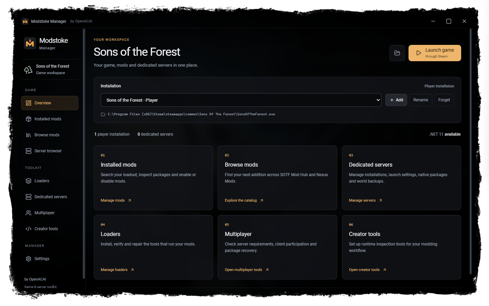
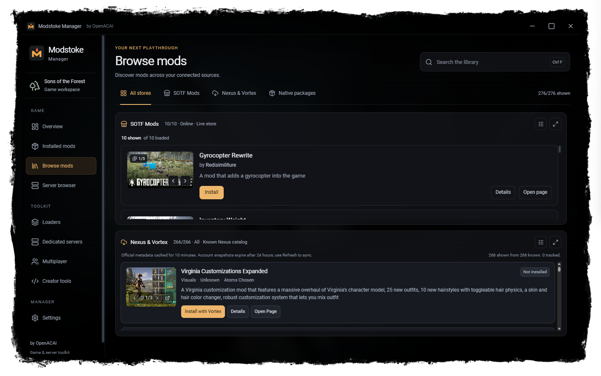

# Modstoke Manager

Modstoke Manager is a Windows toolkit for **Sons of the Forest**, maintained by OpenACAI. It is based on [RedManager](https://github.com/ToniMacaroni/RedManager) by Toni Macaroni. Manage installed mods and loaders, browse SOTF Mods and Nexus Mods, find community servers, and look after local dedicated servers from one app.





The current Manager source is on the [`openacai-tauri2-svelte5-shell` branch](https://github.com/desertofunknown/modstoke-manager/tree/openacai-tauri2-svelte5-shell). Some installed paths, such as the program file `OpenACAI Mod Manager.exe`, still use OpenACAI names for compatibility. The Manager reads the community server list and the loader release feed from modstoke.com; its mod catalog addresses are unchanged. See the [rename compatibility notes](docs/BRAND_COMPATIBILITY.md) and [changelog](CHANGELOG.md).

## Download the Windows app

Download **Modstoke Manager 0.3.0** for Windows x64 from modstoke.com:

- [Installer, Windows x64](https://modstoke.com/downloads/manager/0.3.0/Modstoke-Manager-0.3.0-x64-setup.exe), 5.3 MB
- SHA256 `511f9a71c16811604a1fb27c49ac8f613395f0138ff78685b668c334b7b691b0`
- [Release notes](https://modstoke.com/releases/#manager-0-3-0) and [install guide](https://modstoke.com/guides/install-modstoke-manager/)

The installer and the programs it installs are signed by **OpenACAI Inc**. You can [check a download's hash and signature](docs/TROUBLESHOOTING.md#check-a-downloaded-executable) before running it. The older signed 0.2.0 files, which still display OpenACAI Mod Manager, remain in [`prebuilt/`](prebuilt/) for reference.

## Get started

These steps describe Manager 0.3.0.

1. Run the Manager on Windows 10 or 11. WebView2 is required; the installer bootstraps it if needed.
2. Select **Add** and choose `SonsOfTheForest.exe` in your game installation folder.
3. Use **Installed mods** for your loadout, **Browse mods** for the catalogs, and **Loaders** to install or repair the loader and to follow the Loader console of a running game. Nexus file installation is handed to Vortex; manage Vortex deployments there.
4. Open **Dedicated servers** to add an existing server installation (`SonsOfTheForestDS.exe`), choose its data folder, and edit its name, player limit, game settings and Admin staff permissions. From there you can start, stop or restart the server, follow its logs and Loader console, install packages, and manage world backups. See the [server setup guide](docs/DEDICATED_SERVERS.md).
5. Open **Server browser** to find community servers. Before joining through Steam, the Manager checks the server's current details and compares its required mods with the files in your selected game installation.
6. Use **Multiplayer** for server requirement lists, Modstoke Client participation, package recovery and Admin staff permissions for games you host. Use **Settings** to choose a skin; the default, Match the game, uses the Sons of the Forest skin when a player installation is saved.

**Loader install and repair need a Loader release on modstoke.com, which has not been published yet.** The Manager requests `OpenACAILoader.manifest.json` from [modstoke.com](https://modstoke.com/releases/loader/latest/OpenACAILoader.manifest.json) and downloads the package it names from `modstoke.com/downloads/loader/`. The 0.2.0 files request an old GitHub address that is no longer available. The loader cannot be installed from a local ZIP. Install and repair will work once the Loader release is published. See [troubleshooting](docs/TROUBLESHOOTING.md#loader-install-says-the-manifest-is-unavailable) for the errors you may see.

Sign in with your Nexus Mods account through your browser. The Manager uses Nexus's OAuth sign-in with PKCE and never asks for a personal API key. See the [Nexus integration notes](docs/NEXUS_API_REVIEW.md) for account handling and the OAuth registration.

## Develop on Windows

Install Node.js 22.12 or newer, Rust/Cargo, and the [Tauri 2 Windows prerequisites](https://v2.tauri.app/start/prerequisites/#windows), including Visual Studio C++ build tools and WebView2. You can build the Manager without installing the game or a .NET SDK. Building the separate loader package has different requirements.

```powershell
git clone --branch openacai-tauri2-svelte5-shell --single-branch https://github.com/desertofunknown/modstoke-manager.git
cd modstoke-manager
npm ci
npm run check
npm run tauri dev
```

For a local Windows build:

```powershell
npm run tauri build
```

The executable is `src-tauri/target/release/OpenACAI Mod Manager.exe` (the filename is kept for compatibility), and the NSIS installer is under `src-tauri/target/release/bundle/nsis/`. Local builds are unsigned. Builds committed to `prebuilt/` must be signed first; see [code signing](docs/SIGNING.md). `npm run build` builds only the web frontend.

The Svelte frontend lives in `src/`, and the Rust/Tauri backend in `src-tauri/`. Loader, SDK, and Admin are separate projects. Admin is not included in this repository or its Manager downloads.

## Credits and licenses

OpenACAI-authored Manager changes are licensed under [GPL-3.0-or-later](https://github.com/desertofunknown/modstoke-manager/blob/openacai-tauri2-svelte5-shell/LICENSE). The RedManager source retains its [Apache-2.0 license](https://github.com/desertofunknown/modstoke-manager/blob/openacai-tauri2-svelte5-shell/LICENSES/Apache-2.0.txt). See the [third-party notices](https://github.com/desertofunknown/modstoke-manager/blob/openacai-tauri2-svelte5-shell/THIRD_PARTY_NOTICES.md) and [upstream lineage](https://github.com/desertofunknown/modstoke-manager/blob/openacai-tauri2-svelte5-shell/UPSTREAMS.md) for other components.

The Manager ships no Sons of the Forest art. Its Sons of the Forest skin reads the menu frame and title screen backdrop, which belong to Endnight Games, and the game's copy of Google's Roboto font from your own installation, and keeps them only in your local app data. Modstoke Manager is independent and is not endorsed by Endnight Games.
